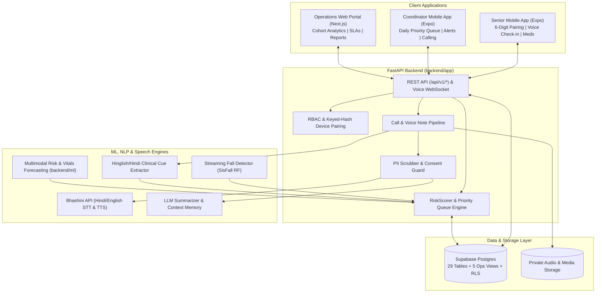

# SamarthCare AI — Early Warning & Care Coordination System for Seniors Living at Home

[](https://www.python.org/)
[](https://fastapi.tiangolo.com/)
[](https://nextjs.org/)
[](https://expo.dev/)
[](https://supabase.com/)

> **Hackathon Brief (DEV_104 — Samarth Life Management)**: Detect gradual physical, cognitive, or emotional decline in seniors living independently at home **3–14 days before an acute crisis**, and tell a Care Coordinator **who needs attention today, why, and what to do next**.

> [!IMPORTANT]
> **Clinical & Synthetic Data Disclaimer**: SamarthCare AI is a **non-diagnostic decision-support and triage tool**. It flags longitudinal drift and routes cases to human Care Coordinators; it never diagnoses medical conditions. All cohort records, vital measurements, check-in transcripts, and clinical scenarios in this repository are **100% synthetic**.

---

## 1. Overview & Core Philosophy

Seniors living alone rarely experience sudden health crises out of nowhere—most emergencies are preceded by subtle, multi-day warning signs: creeping blood pressure, a few missed doses of medication, reduced daytime movement, social withdrawal, or casual mentions of dizziness in a Hindi/Hinglish phone check-in.

**SamarthCare AI** bridges these fragmented signals into a unified, low-friction care ecosystem built around five design principles:
1. **Non-Diagnostic Triage**: Surfaces risk scores, plain-language explanations, and concrete next actions for human coordinators—never medical diagnoses.
2. **Low-Tech Accessibility for Seniors**: Passwordless 6-digit device pairing, multilingual voice check-ins (Hindi, Hinglish, English via Bhashini), and simple 1-tap confirmations.
3. **Personalized Baselines over Population Averages**: Evaluates each senior against their own rolling physiological and behavioral steady state (EWMA, Z-scores, and causal rolling windows) combined with hard clinical safety tripwires.
4. **Zero Alert Fatigue**: Sub-category saturation caps, alert lifecycle deduplication (`OPEN` -> `ACKNOWLEDGED` -> `ESCALATED` -> `RESOLVED`), and coordinator feedback loops keep daily priority queues sharp and actionable.
5. **Privacy by Default**: Strict Row-Level Security (RLS), consent-gated family views, and automatic PII masking (names and phone numbers scrubbed before any external LLM call).

---

## 2. Key Capabilities & Features

### Multimodal Signal Ingestion
- **Structured Vitals**: Systolic/Diastolic BP, $\text{SpO}_2$, Blood Glucose, Heart Rate/Pulse, and Weight—handling missing days, measurement jitter, and irregular reporting frequencies.
- **Medication Adherence Intelligence**: Dose-level schedule tracking, multi-day missed-dose streak detection, and critical medication omission flags (e.g., anticoagulants, insulin, antihypertensives).
- **Sensor-Based Fall & Activity Detection**: Real-time tri-axial accelerometer streaming pipeline trained on the **SisFall** dataset using circular buffer triggering, a 3.5-second post-impact immobility confirmation window, and off-body drop rejection—paired with daily pedometer and sleep drift tracking.
- **Community & Social Engagement**: Tracking participation and silence streaks to catch early depressive apathy or social withdrawal.

### Unstructured Health & Voice Understanding (Hindi / Hinglish / English)
- **Multilingual NLP Extractor**: Clause-level negation propagation, historical context filtering, and uncertainty tracking across English, Hindi, and code-mixed *Hinglish* notes.
- **Clinical & Wellbeing Cue Extraction**: Automatically tags mentions of pain, dizziness, confusion/memory lapse, low appetite, loneliness, breathlessness, and unreported falls.
- **Context-Aware AI Voice Check-ins**: Dynamic 3–4 question daily wellbeing check-ins powered by **Bhashini** (STT/TTS) and an LLM agent with cross-call memory of open concerns and recent missed medications.
- **Call Recording & Transcription Pipeline**: Dual-channel call ingestion (`POST /api/v1/calls/import` & telephony bridge) that transcribes, masks PII, summarizes, extracts clinical cues, and triggers immediate same-day risk re-scoring.

### Personalized Anomaly & Risk Scoring Engine
- **Calibrated Composite Score ($[0\text{–}100]$)**: Categorized into `LOW` (0–24), `MODERATE` (25–49), `HIGH` (50–74), and `URGENT_REVIEW` (75–100).
- **Independent Safety Tripwires**: Acute red flags (mechanical falls, hypertensive spikes $\ge 170\text{ mmHg}$, or hypoxia $\le 92\%\text{ SpO}_2$) immediately force `URGENT_REVIEW` ($\ge 75$) regardless of calm averages in other channels.
- **Multimodal Risk Fusion**: Combines vital forecasting, activity/immobility drift, NLP check-in cues, and medication adherence with condition-specific sensitivity modifiers.

### Role-Based Experiences
- **Senior Mobile Experience (`SAHAJ_APP`)**: Passwordless 6-digit pairing code login, 1-tap medication confirmation, self-reported vitals, voice notes, and AI voice check-ins.
- **Care Coordinator Mobile App (`SAHAJ_APP`)**: Ranked daily priority queue with plain-language *"Why this score"* explanations and *"Suggested next action"*, full senior longitudinal drill-down, call logging, and alert resolution with usefulness feedback.
- **Operations Manager Web Portal (`frontend/web`)**: City- and team-wide visibility into alert volumes, SLA response times, coordinator caseloads, triage outcomes, and cohort health reports.

---

## 3. System Architecture & Tech Stack



### Tech Stack

| Layer | Technologies |
| :--- | :--- |
| **Backend API** | Python 3.11+, FastAPI, SQLAlchemy 2.0, Alembic, Pydantic v2, Uvicorn |
| **Database & Auth** | Supabase Postgres (29 tables, 5 `v_ops_*` analytical views, Row-Level Security), JWT + Keyed-Hash Device Tokens |
| **Machine Learning & NLP** | Scikit-learn, NumPy, SciPy, Pandas, Joblib (Causal rolling Z-scores, Isolation Forest, Random Forest SisFall streaming detector, Multilingual rule/cue NLP) |
| **Speech & GenAI** | Bhashini (Indian language STT/TTS), AWS Bedrock / Claude LLM interface (with deterministic fallback stubs) |
| **Web Portal (Ops/Admin)** | Next.js (App Router), React, TypeScript, Tailwind CSS, Vitest |
| **Mobile App (Coord/Senior)** | React Native, Expo Router, TypeScript |

---

## 4. Repository Structure

```text
├── samarth-2.O/
│   ├── backend/
│   │   ├── app/                    # FastAPI application (~60 endpoints + WebSocket)
│   │   │   ├── api/v1/             # Route handlers (auth, seniors, alerts, calls, ops, etc.)
│   │   │   ├── core/               # Config, security, privacy masking
│   │   │   ├── db/                 # SQLAlchemy models, session, synthetic cohort seeder
│   │   │   └── services/           # Risk scoring, voice/STT/TTS, LLM, priority lists
│   │   ├── migrations/             # Alembic schema & RLS migrations (up to 0004)
│   │   ├── ml/                     # Synthetic cohort generator, Phase 2 risk engine & eval
│   │   │   ├── config/             # dataset_config.yaml
│   │   │   ├── data/               # raw/, processed/ (18,000 master rows), evaluation/
│   │   │   ├── models/             # Vitals forecasting & anomaly detection artifacts
│   │   │   ├── src/                # Feature builders, NLP extractor, scoring, evaluation
│   │   │   └── docs/               # Model card, risk methodology, data dictionary
│   │   ├── docs/                   # api-contract.md, database-schema.md, system-overview.md
│   │   └── tests/                  # 338 API/service tests (tests/app) + ML invariant suites
│   ├── frontend/
│   │   ├── web/                    # Next.js Operations Manager portal (Overview, Seniors, Alerts, Reports)
│   │   └── SAHAJ_APP/              # Expo React Native app for Care Coordinators & Seniors
│   └── docs/
│       └── PROJECT_STATE.md        # Live architecture state, decisions, and environment notes
└── SamarthExtended/
    ├── fall_detection/             # Standalone real-time accelerometer fall detection engine
    │   ├── features.py             # Time/frequency domain feature extraction
    │   ├── train_rf.py             # SisFall Random Forest training pipeline
    │   ├── streaming_fall_detector.py # Circular buffer + 3.5s post-impact confirmation state machine
    │   └── test_streaming.py       # Streaming verification suite
    └── ideation/
        └── features_checklist.md   # Full capability & stretch-goal matrix
```

---

## 5. Synthetic Cohort & Evaluation Methodology

To rigorously benchmark early warning performance without exposing real patient data, the project includes a deterministic **Longitudinal Synthetic Cohort Generator**:

- **Scale**: **250 seniors** and **125 care coordinators** simulated over a ~90-day observation window (`2026-07-06` to `2026-10-11`), plus an 18,000 senior-day consolidated analytical master dataset (`backend/ml/data/processed/master_dataset.csv`) combining 55,581 vitals, 52,110 medication events, and 12,828 multilingual check-ins.
- **Realistic Telemetry Artifacts**: Simulates missing reporting days, sensor dropouts, measurement noise, cuff artifacts, and code-mixed Hinglish conversational transcripts.
- **Planted Gradual Decline Archetypes**:
  - *Silent UTI / Early Sepsis Drift* (subtle heart rate elevation + mild confusion cues + appetite drop)
  - *Congestive Heart Failure (CHF) Fluid Retention* (multi-day weight creep + nocturnal breathlessness + $\text{SpO}_2$ dip)
  - *Post-Fall Fear-of-Falling & Immobility Spiral* (unreported minor slip + sharp step-count drop + social withdrawal)
  - *Depressive Apathy & Social Withdrawal* (missed hobby club messages + flattened sentiment + skipped morning meds)
  - *Cognitive Drift & Medication Confusion* (erratic adherence streaks + repeated questions in call notes)
- **Strict Ground-Truth Quarantine**: Ground-truth decline episode labels live exclusively in `backend/ml/data/evaluation/` and are never loaded into the operational database or exposed to the scoring engine.
- **Evaluation Metrics**: Benchmarked on **Episode-Level Recall**, **Precision**, **Detection Lead-Time (Days Early prior to crisis)**, and **False Alerts per Coordinator per Week**.

---

## 6. Getting Started (Local Setup & Installation)

### Prerequisites
- **Python** 3.11+
- **Node.js** 18+ and `npm`
- **PostgreSQL / Supabase** project (or connection URL in `backend/.env`)

### 1. Backend API Setup
```bash
cd backend

# Create and activate virtual environment
python -m venv .venv
# Linux/macOS: source .venv/bin/activate
# Windows PowerShell: .venv\Scripts\Activate.ps1

# Install dependencies
pip install -r requirements.txt

# Configure environment variables
cp .env.example .env
# Edit .env with your DATABASE_URL, JWT secret, and optional Bhashini/LLM keys

# Run database migrations
python -m alembic upgrade head

# (Optional) Seed the 250-senior synthetic cohort (~40 seconds)
python -m app.db.seed --reset

# Start the FastAPI server (0.0.0.0 allows mobile devices on LAN to connect)
uvicorn app.main:app --host 0.0.0.0 --port 8000
```
Interactive OpenAPI docs are available at `http://localhost:8000/docs`.

### 2. Operations Manager Web Portal (`frontend/web`)
```bash
cd frontend/web

npm install

# Configure .env.local
# NEXT_PUBLIC_DATA_SOURCE=live
# NEXT_PUBLIC_API_BASE_URL=http://localhost:8000/api/v1
# NEXT_PUBLIC_DEMO_DATE=2026-10-11

npm run dev
```
Open `http://localhost:3000` in your browser.

### 3. Coordinator & Senior Mobile App (`frontend/SAHAJ_APP`)
```bash
cd frontend/SAHAJ_APP

npm install

# Configure .env with your machine's LAN IP (or 10.0.2.2 for Android Emulator)
# EXPO_PUBLIC_API_BASE_URL=http://<YOUR_LAN_IP>:8000/api/v1
# EXPO_PUBLIC_ENABLE_REAL_CALLS=false

npx expo start
```

### 4. Standalone Fall Detection & ML Pipeline
```bash
# Run the Phase 1 & Phase 2 ML Risk Engine pipeline
cd backend/ml
python src/run_pipeline.py
python src/run_phase2.py

# Test the real-time streaming accelerometer fall detector
cd ../../SamarthExtended/fall_detection
python test_streaming.py
```

---

## 7. Demo Walkthrough & Test Access

### Simulated Demo Clock (`DEMO_TODAY`)
The synthetic cohort's observation window concludes on **`2026-10-11`**. Setting `DEMO_TODAY=2026-10-11` in `backend/.env` and `NEXT_PUBLIC_DEMO_DATE=2026-10-11` in `frontend/web/.env.local` pins the system's "today" to the final day of the simulation so daily priority queues, longitudinal trends, and active alerts render immediately.

### Role-Based Demo Accounts
> [!NOTE]
> Passwords for seeded demo accounts are displayed on the web login helper banner and stored locally in `backend/.seed_credentials.txt` (gitignored).

1. **Operations Manager (Web Portal only)**:
   - Login: `ops@demo.samarth.local` or `admin@demo.samarth.local`
   - Explore system-wide alert volumes, coordinator response times, senior profiles, and triage outcome reports.
2. **Care Coordinator (Mobile App)**:
   - Login: `coord_001@demo.samarth.local` (or any seeded coordinator account)
   - View the **Daily Ranked Priority Queue**, inspect an urgent senior (e.g., *Mohan Singh, S0094*), read the plain-language explanation and suggested action, upload/trigger a check-in call, and resolve or escalate alerts with usefulness feedback.
3. **Senior Citizen (Mobile App — Passwordless Pairing)**:
   - In the Coordinator mobile app (or via API), generate a **6-digit one-time pairing code** (valid for 10 minutes) for a senior.
   - On the Senior login screen, enter the 6-digit code. The device receives a long-lived token and never prompts for a password again.

---

## 8. Testing & Verification

Run each test suite from its respective directory:

```bash
# 1. Backend API & Service Tests (338 tests)
cd backend
python -m pytest tests/app -q

# 2. Web Portal & Shared Mobile Logic Tests (118 tests) + Type Check
cd frontend/web
npm test
npm run type-check

# 3. Mobile App Type Check, Lint & Bundle Verification
cd frontend/SAHAJ_APP
npx tsc --noEmit
CI=1 npx expo lint
```

---

## 9. Privacy, Safety & Guardrails

- **Strict Non-Diagnostic Boundary**: Prompts, rules, and UI templates are engineered to describe observable trends (*"BP averaged 158/94 over the last 3 days, up from baseline 128/80, alongside 2 missed Telmisartan doses"*) and suggest coordinator workflows (*"Call to verify medication adherence and schedule nurse visit"*) without diagnosing pathology.
- **Automated PII Masking**: Before any transcript or note is sent to an external LLM provider, names, phone numbers, and identifiers are replaced with neutral placeholders.
- **Database Isolation**: All 29 operational tables in Supabase Postgres enforce Row-Level Security (RLS) with anonymous/public API roles revoked.
- **Rate-Limited Pairing**: Senior 6-digit pairing codes are stored exclusively as keyed hashes and rate-limited to 10 attempts per minute per IP.

---

## 10. Documentation & References

Detailed architectural and technical specifications are maintained in the repository docs:
- [Project State & Live Architecture (`docs/PROJECT_STATE.md`)](docs/PROJECT_STATE.md)
- [System Overview & Product Plan (`backend/docs/system-overview.md`)](backend/docs/system-overview.md)
- [Backend REST & WebSocket API Contract (`backend/docs/api-contract.md`)](backend/docs/api-contract.md)
- [Database Schema & Views Specification (`backend/docs/database-schema.md`)](backend/docs/database-schema.md)
- [ML Risk Engine & Master Dataset Documentation (`backend/ml/README.md`)](backend/ml/README.md)
- [Phase 2 Mathematical Risk Methodology (`backend/ml/docs/phase2_risk_methodology.md`)](backend/ml/docs/phase2_risk_methodology.md)
- [Model Card & Benchmark Metrics (`backend/ml/docs/phase2_model_card.md`)](backend/ml/docs/phase2_model_card.md)
- [Safety, Privacy & Limitations (`backend/ml/docs/phase2_safety_and_limitations.md`)](backend/ml/docs/phase2_safety_and_limitations.md)
