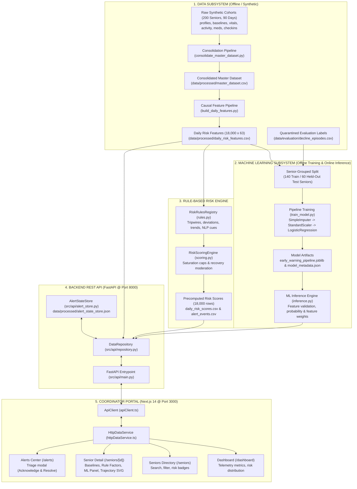
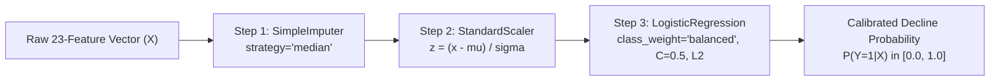

# SAMARTH AI — COMPLETE MODEL, ML TRAINING & SYSTEM TECHNICAL DOCUMENTATION
**System Version**: 2.0.0  
**Document Classification**: Architectural Reference, Machine Learning Model Card & MLOps Manual  
**Target Audience**: Technical Reviewers, Hackathon Judges, Data Scientists, Software Engineers, and ML Students  
**Environment**: Python 3.13.7 | Scikit-Learn 1.8.0 | FastAPI 0.141.1 | Next.js 14.2.35 | TypeScript 5.6.3  
**Status**: Authoritative Verified Implementation Reference  

---

## SECTION 1: EXECUTIVE SUMMARY

### 1.1 What Samarth AI Does
SamarthCare AI is a longitudinal, multimodal early-warning and clinical triage decision-support platform designed for Care Coordinators monitoring senior citizens living independently at home. The system passively aggregates daily physiological vitals, pedometer mobility, sleep fragmentation logs, medication administration events, conversational check-in dialogues, and authorized caregiver observations.

By analyzing multi-day shifts rather than isolated snapshot values, Samarth AI detects sub-acute physiological decline, acute medical emergencies (falls, severe hypertensive spikes, hypoxia), and medication adherence breakdowns before they culminate in preventable emergency department visits or hospitalization.

### 1.2 The Problem It Addresses
Elderly individuals aging in place frequently experience insidious health deterioration—such as gradual orthostatic instability, progressive appetite loss, or intermittent cognitive fog—that family members and episodic clinical visits overlook. Conversely, acute events like unwitnessed slips or nocturnal desaturation require rapid coordinator intervention. Traditional monitoring tools often fail because they either:
1. Rely on rigid, unpersonalized population thresholds (triggering alert fatigue for seniors whose baseline systolic BP naturally runs at 145 mmHg), or
2. Employ black-box machine learning models that lack explainability, hallucinate risk spikes without clinical justifications, or fail silently on acute emergencies.

### 1.3 Intended Users and Workflow
The primary users are **Care Coordinators**, geriatric nurses, and remote care management teams. The application equips coordinators with:
- An enterprise population dashboard tracking risk distributions and alert queues.
- A searchable senior catalog with personalized risk badges.
- Individual senior profiles highlighting personalized steady-state priors, longitudinal trend charts, and active clinical factor breakdowns.
- An interactive alert triage center supporting auditable acknowledgement and resolution workflows.

### 1.4 Dual-Track Decision Support: Complementary Rule Engine & ML Model
Samarth AI does not force a false dichotomy between rules and machine learning. Instead, it deploys a **dual-track architecture**:
- **Track 1 (Explainable Rule Engine)**: Evaluates daily deviations against the senior's individual physiological priors, enforces category saturation caps (capping respiratory or mobility contributions at sensible limits), and executes **independent safety tripwires** ($\text{SpO}_2 \le 92\%$, systolic $\text{BP} \ge 170\text{ mmHg}$, or mechanical falls immediately force risk scores to $\ge 75$ `URGENT_REVIEW`).
- **Track 2 (Supervised Statistical ML Pipeline)**: Evaluates a 23-feature causal observation matrix using a calibrated logistic regression pipeline to output an objective decline probability ($P(\text{Decline})$) and directional feature influence weights.

```
+---------------------------------------------------------------------------------------------------+
|                                    DUAL-TRACK DECISION SUPPORT                                    |
|                                                                                                   |
|   +---------------------------------------+       +-------------------------------------------+   |
|   |   TRACK 1: RULE-BASED SCORING         |       |   TRACK 2: STATISTICAL ML PIPELINE        |   |
|   |   • Baseline-relative scoring (0-100) |       |   • Causal 23-feature observation matrix  |   |
|   |   • Category saturation caps          |       |   • Calibrated logistic regression        |   |
|   |   • Hard safety tripwires (falls, O2) |       |   • Multivariate deterioration prob       |   |
|   |   • Deterministic, 100% explainable   |       |   • Ranked feature influence weights      |   |
|   +---------------------------------------+       +-------------------------------------------+   |
|                       \                                           /                               |
|                        \                                         /                                |
|                         v                                       v                                 |
|   +-------------------------------------------------------------------------------------------+   |
|   |                         UNIFIED CARE COORDINATOR PROFILE VIEW                             |   |
|   |   • Side-by-side rule explanations & ML anomaly scores                                    |   |
|   |   • Complete clinical context prevents alert fatigue & eliminates algorithmic blind spots|   |
|   +-------------------------------------------------------------------------------------------+   |
+---------------------------------------------------------------------------------------------------+
```

### 1.5 Medical & Regulatory Disclaimer
> [!CAUTION]
> **NON-DIAGNOSTIC DECISION SUPPORT SYSTEM**  
> Samarth AI is an engineering prototype and algorithmic benchmarking platform built on synthetic cohorts. It is **not** a certified medical device, does not diagnose medical conditions, does not prescribe pharmaceutical interventions, and has not undergone prospective clinical validation. All predictions, risk scores, and alerts must be evaluated by qualified human healthcare professionals in conjunction with direct patient communication.

---

## SECTION 2: SYSTEM ARCHITECTURE

### 2.1 End-to-End System Diagram
The following Mermaid architecture diagram illustrates the end-to-end data lifecycle, from offline synthetic generation to real-time coordinator triage:



### 2.2 Execution Lifecycles: Offline, Training, and Online Inference
1. **Offline Preprocessing**:
   - `src/run_pipeline.py`: Generates the 200-senior synthetic cohort across 8 raw tables.
   - `src/consolidate_master_dataset.py`: Merges measurements into 18,000 senior-day rows.
   - `src/features/build_daily_features.py`: Computes 1d, 3d, and 7d causal rolling statistics and extracts NLP cues.
   - `src/run_phase2.py`: Evaluates the deterministic rules engine and outputs operational scores.
2. **Training Time**:
   - `src/risk_engine/train_model.py`: Reads `daily_risk_features.csv`, merges binary target labels from quarantined `decline_episodes.csv`, partitions seniors into 140 train and 60 test seniors, fits the `Pipeline`, logs generalization metrics, and serializes `early_warning_pipeline.joblib`.
3. **Inference Time (Operational Online Execution)**:
   - FastAPI loads `early_warning_pipeline.joblib` and `model_metadata.json` into a thread-safe singleton (`MLInferenceEngine`).
   - When a coordinator navigates to a senior's profile, the backend extracts the senior's latest row from `daily_risk_features.csv`, executes `pipeline.predict_proba()`, extracts top positive feature weights via model coefficients, and bundles the result into `SeniorProfileDetail`.

---

## SECTION 3: TECHNOLOGIES AND LIBRARIES

The entire technology stack was verified directly against `pyproject.toml`, `requirements.txt`, `frontend/package.json`, and running Python/Node runtime environments:

| Technology / Library | Verified Version | Purpose | Architectural Location | Evidence in Repository |
| :--- | :--- | :--- | :--- | :--- |
| **Python** | `3.13.7` | Core backend, data processing, and ML language | Root / Environment | Runtime `python --version` |
| **scikit-learn** | `1.8.0` | Imputation, standardization, logistic regression, and evaluation | `src/risk_engine/train_model.py` | `import sklearn; sklearn.__version__` |
| **pandas** | `2.3.3` | High-performance tabular manipulation, joins, and rolling windows | `src/features/`, `src/api/repository.py` | `import pandas; pandas.__version__` |
| **NumPy** | `2.4.2` | Numerical linear algebra, array broadcasting, and vectorized math | `src/risk_engine/scoring.py` | `import numpy; numpy.__version__` |
| **joblib** | `1.5.3` | Serialization and deserialization of the trained Scikit-Learn pipeline | `src/risk_engine/train_model.py`, `inference.py` | `import joblib; joblib.__version__` |
| **FastAPI** | `0.141.1` | High-performance asynchronous REST API framework | `src/api/main.py` | `import fastapi; fastapi.__version__` |
| **Pydantic** | `2.13.4` | Strict request/response schema validation and contract typing | `src/api/schemas.py` | `import pydantic; pydantic.__version__` |
| **Uvicorn** | `0.52.1` | Lightning-fast ASGI web server hosting the FastAPI backend | `src/api/` runner | `import uvicorn; uvicorn.__version__` |
| **Pytest** | `9.1.1` | Backend automated regression testing (87 tests) | `tests/` | `python -m pytest --version` |
| **Node.js** | `v24.13.0` | Frontend JavaScript execution engine | Host Environment | `node -v` |
| **npm** | `11.6.2` | Frontend dependency management | Host Environment | `npm -v` |
| **Next.js** | `14.2.35` | App router, server-side rendering, and production web framework | `frontend/` | `frontend/package.json` |
| **React** | `18.3.1` | Declarative component UI library | `frontend/src/` | `frontend/package.json` |
| **TypeScript** | `5.6.3` | Strict client-side type-checking and contract alignment | `frontend/tsconfig.json` | `tsc --version` |
| **Tailwind CSS** | `3.4.15` | Utility-first accessible responsive styling framework | `frontend/tailwind.config.ts` | `frontend/package.json` |
| **Lucide React** | `0.454.0` | Accessible icon library for coordinator clinical telemetry | `frontend/src/components/` | `frontend/package.json` |
| **Vitest** | `2.1.9` | Blazing-fast Vite-native frontend test runner (44 tests) | `frontend/src/tests/` | `frontend/package.json` |

---

## SECTION 4: DATASET DESCRIPTION

### 4.1 Master Data Inventory Table
All file paths, row counts, and column counts were programmatically verified from the active filesystem:

| Dataset / File Location | Verified Rows | Verified Cols | Key Primary / Foreign Fields | Purpose in System | Lifecycle Role |
| :--- | ---:| ---:| :--- | :--- | :--- |
| `data/raw/senior_profiles.csv` | 200 | 11 | `senior_id`, `age`, `preferred_language`, `city_id`, `living_arrangement` | Demographic and administrative registry | Operational Source |
| `data/raw/senior_baselines.csv` | 200 | 14 | `senior_id`, `baseline_bp_systolic`, `baseline_spo2`, `baseline_steps` | Personalized steady-state physiological priors | Operational Source |
| `data/raw/daily_activity.csv` | 18,000 | 10 | `senior_id`, `date`, `steps`, `active_minutes`, `sleep_hours` | Pedometer mobility logs and sleep durations | Operational Source |
| `data/raw/vitals.csv` | 55,581 | 9 | `measurement_id`, `senior_id`, `timestamp`, `measurement_type`, `measurement_value` | Timestamped measurement-level vital signs | Operational Source |
| `data/raw/medication_schedules.csv`| 434 | 6 | `medication_id`, `senior_id`, `scheduled_start_date`, `frequency` | Prescribed pharmaceutical regimens | Operational Source |
| `data/raw/medication_events.csv` | 52,110 | 8 | `medication_event_id`, `senior_id`, `medication_id`, `status` | Dose administration audit logs | Operational Source |
| `data/raw/checkins.csv` | 12,828 | 10 | `checkin_id`, `senior_id`, `timestamp`, `channel`, `raw_note` | Conversational check-in transcripts (Hindi/Hinglish/English) | Operational Source |
| `data/raw/family_observations.csv`| 2,167 | 8 | `observation_id`, `senior_id`, `timestamp`, `observation_type`, `consent_valid` | Consent-gated caregiver observations | Operational Source |
| `data/processed/master_dataset.csv` | 18,000 | 30 | `senior_id`, `date`, `bp_systolic_mean`, `steps`, `sleep_hours` | Lossless analytical senior-day master consolidation | Analytical Master |
| `data/processed/daily_risk_features.csv`| 18,000 | 63 | `senior_id`, `date`, `bp_systolic_dev_baseline`, `spo2_rolling_3d` | Causal feature-engineered matrix for rules & ML | Training / Inference |
| `data/processed/daily_risk_scores.csv` | 18,000 | 10 | `senior_id`, `date`, `risk_score`, `risk_level`, `top_contributing_factors` | Precomputed daily rule-based scores and explanations | Operational Output |
| `data/processed/alert_events.csv` | 546 | 9 | `alert_id`, `senior_id`, `created_at`, `status`, `triggering_signals` | Deduplicated coordinator early-warning alerts | Operational Output |
| `data/processed/nlp_annotations.csv`| 15,933 | 9 | `annotation_id`, `checkin_id`, `cue_type`, `cue_value`, `negation_detected` | Ground-truth semantic extractions from check-ins | Intermediate Feature |
| `data/evaluation/decline_episodes.csv`| 200 | 10 | `episode_id`, `senior_id`, `episode_type`, `onset_date`, `end_date`, `planted` | Hidden ground-truth clinical decline episodes | Evaluation (Quarantined) |
| `data/evaluation/master_dataset_with_ground_truth.csv`| 18,000 | 38 | `senior_id`, `date`, `has_decline_episode`, `acute_incident_label` | Research evaluation export containing future outcome labels | Evaluation (Quarantined) |

### 4.2 Entity Relational Integrity
- **Primary Entity**: The monitored senior, uniquely identified by a 5-character string (`S0001` through `S0200`).
- **Longitudinal Temporal Key**: The observation calendar date (`YYYY-MM-DD`), spanning exactly 90 days from `2026-01-01` to `2026-03-31`.
- **Compound Primary Key**: `(senior_id, date)` defines a single senior-day. Each senior has exactly 90 senior-day rows, producing an exact, perfectly balanced rectangular matrix of $200 \times 90 = 18,000$ daily observations.
- **Foreign Keys**:
  - `vitals.csv`, `daily_activity.csv`, `checkins.csv`, `medication_events.csv` link to `senior_profiles.csv` via `senior_id`.
  - `medication_events.csv` links to `medication_schedules.csv` via `medication_id`.

---

## SECTION 5: DATA GENERATION AND CONSOLIDATION

### 5.1 Synthetic Generation Methodology
The dataset generation pipeline is orchestrated by `src/run_pipeline.py` with deterministic parameterization configured in `config/dataset_config.yaml`.
1. **Demographic Simulation (`src/generate_profiles.py`)**:
   - Generates 200 realistic Indian senior profiles across tier-1 and tier-2 cities (`CITY_CHANDIGARH`, `CITY_JAIPUR`, `CITY_LUCKNOW`, `CITY_DELHI`, `CITY_PUNE`).
   - Assigns language preferences (Hindi: 50%, Hinglish: 30%, English: 20%) and living arrangements (`alone`, `with_spouse`, `with_family`).
2. **Individual Physiological Priors (`src/generate_baselines.py`)**:
   - Rather than assigning global normal thresholds, each senior is assigned a personalized steady-state baseline drawn from truncated normal distributions:
     $$\text{Baseline SBP} \sim \mathcal{N}(128, 12)\text{ mmHg}, \quad \text{Baseline SpO}_2 \sim \mathcal{N}(97.0, 1.2)\%, \quad \text{Baseline Steps} \sim \mathcal{N}(3800, 950)$$
3. **Multimodal Temporal Telemetry (`src/generate_vitals.py`, `generate_activity.py`, `generate_medications.py`)**:
   - Incorporates physiological diurnal rhythms (e.g. morning blood pressure surge).
   - Generates measurement noise, missingness patterns (e.g. forgotten pedometer charging), and scheduled prescription dose outcomes (`TAKEN`, `MISSED`, `DELAYED`).
4. **Planted Decline Episodes (`src/generate_episodes.py`)**:
   - To benchmark detection algorithms, exactly 100 clinical decline episodes were planted across the cohort:
     - `gradual_decline` (37 episodes): Progressive mobility decay, appetite loss, and weight reduction over 2 to 4 weeks.
     - `acute_event` (20 episodes): Sudden slips/falls, acute hypertensive crises ($\ge 175\text{ mmHg}$), or severe hypoxia ($\le 91\%$).
     - `intermittent_concern` (40 episodes): Transitory dizzy spells or sleep disruption.
     - `recovery_trajectory` (3 episodes): Post-incident convalescence.

### 5.2 Consolidation Engine (`src/consolidate_master_dataset.py`)
The consolidation script joins raw measurement tables into a canonical analytical table (`master_dataset.csv`):
- Aggregates intraday vitals to daily summary statistics (`mean`, `min`, `max`, `latest`).
- Resolves medication adherence to daily compliance percentages.
- Validated via `master_dataset_validation.json`, confirming exact row counts ($18,000$), zero orphan records, and referential integrity across all foreign keys.

---

## SECTION 6: DATA PREPROCESSING AND FEATURE ENGINEERING

### 6.1 The Causal Feature Engineering Pipeline (`src/features/build_daily_features.py`)
Features in `daily_risk_features.csv` are strictly **causal**: features for senior $i$ on day $t$ depend solely on observations from days $\tau \le t$. Future records $\tau > t$ are strictly inaccessible.

```
       Historical Past                          Prediction Day (t)               Future (Quarantined)
 <----------------------------------------------|------------------------> <-----------------------------
 ... [Day t-7] ... [Day t-3] ... [Day t-1]       [Day t Observations]       [Day t+1] ... [Day t+7] ...
       7-Day Rolling Trend Window                  Same-Day Telemetry                STRICTLY FORBIDDEN
       • SpO2 7d min / mean                        • Latest SBP, SpO2               (No future aggregates)
       • Mobility rolling ratio                    • Baseline Deviations
       • Consecutive missed doses                  • NLP Cue Flags
```

### 6.2 Key Feature Catalog
The operational matrix comprises 63 columns, from which 23 primary clinical predictors (`FEATURE_COLUMNS`) are extracted for machine learning:

| Feature Name | Primary Source Table | Mathematical Transformation / Calculation | Time Window | Leakage Risk & Safeguard |
| :--- | :--- | :--- | :--- | :--- |
| `bp_systolic_latest` | `vitals.csv` | Most recent SBP measurement on day $t$ | Day $t$ | Zero; same-day observation |
| `bp_systolic_dev_baseline` | `vitals.csv`, `baselines.csv` | $\text{SBP}_{\text{latest}}(t) - \text{Baseline SBP}_i$ | Day $t$ | Zero; baseline established prior to day 1 |
| `bp_systolic_rolling_3d` | `vitals.csv` | $\frac{1}{3}\sum_{k=0}^{2} \text{SBP}_{\text{mean}}(t-k)$ | $[t-2, t]$ | Zero; causal backward rolling window |
| `bp_diastolic_latest` | `vitals.csv` | Most recent DBP measurement on day $t$ | Day $t$ | Zero; same-day observation |
| `spo2_latest` | `vitals.csv` | Most recent pulse oximeter $\text{SpO}_2$ reading on day $t$ | Day $t$ | Zero; same-day observation |
| `spo2_dev_baseline` | `vitals.csv`, `baselines.csv` | $\text{SpO}_{2, \text{latest}}(t) - \text{Baseline SpO}_{2, i}$ | Day $t$ | Zero; baseline established prior to day 1 |
| `spo2_rolling_3d` | `vitals.csv` | $\frac{1}{3}\sum_{k=0}^{2} \text{SpO}_{2, \text{mean}}(t-k)$ | $[t-2, t]$ | Zero; causal backward rolling window |
| `blood_glucose_latest` | `vitals.csv` | Fasting/postprandial glucose reading on day $t$ | Day $t$ | Zero; same-day observation |
| `steps_latest` | `daily_activity.csv` | Total pedometer steps recorded on day $t$ | Day $t$ | Zero; same-day observation |
| `steps_rolling_3d_ratio` | `daily_activity.csv`, `baselines` | $\frac{\text{Steps}_{\text{rolling 3d}}(t)}{\text{Baseline Steps}_i}$ | $[t-2, t]$ | Zero; causal ratio against pre-observation baseline |
| `sleep_hours_latest` | `daily_activity.csv` | Sleep duration hours recorded on day $t$ | Day $t$ | Zero; same-day observation |
| `sleep_dev_baseline` | `daily_activity.csv`, `baselines` | $\text{Sleep}(t) - \text{Baseline Sleep}_i$ | Day $t$ | Zero; baseline established prior to day 1 |
| `appetite_latest` | `checkins.csv` | Subjective appetite rating ($1.0 - 5.0$) on day $t$ | Day $t$ | Zero; same-day check-in score |
| `appetite_dev_baseline` | `checkins.csv`, `baselines` | $\text{Appetite}(t) - \text{Baseline Appetite}_i$ | Day $t$ | Zero; baseline established prior to day 1 |
| `mood_latest` | `checkins.csv` | Subjective mood score ($1.0 - 5.0$) on day $t$ | Day $t$ | Zero; same-day check-in score |
| `adherence_rate_3d` | `medication_events.csv` | $\frac{\text{Doses Taken in }[t-2, t]}{\text{Doses Scheduled in }[t-2, t]}$ | $[t-2, t]$ | Zero; causal backward rolling adherence |
| `consecutive_miss_flag` | `medication_events.csv` | $\mathbb{I}(\text{Unbroken missed dose streak} \ge 2)$ | $[t-2, t]$ | Zero; backward streak evaluation |
| `cue_fall_current` | `checkins.csv` | $\mathbb{I}(\text{NLP extractor detects active slip/fall})$ | Day $t$ | Zero; NLP extraction scoped to day $t$ transcript |
| `cue_weakness_current` | `checkins.csv` | $\mathbb{I}(\text{NLP extractor detects acute weakness})$ | Day $t$ | Zero; NLP extraction scoped to day $t$ transcript |
| `cue_dizziness_current` | `checkins.csv` | $\mathbb{I}(\text{NLP extractor detects dizziness/vertigo})$| Day $t$ | Zero; NLP extraction scoped to day $t$ transcript |
| `cue_pain_current` | `checkins.csv` | $\mathbb{I}(\text{NLP extractor detects severe pain flare})$ | Day $t$ | Zero; NLP extraction scoped to day $t$ transcript |
| `cue_distinct_concerns_count`| `checkins.csv` | Total count of distinct affirmative clinical cues | Day $t$ | Zero; bounded count on day $t$ |
| `family_mobility_flag` | `family_observations.csv`| $\mathbb{I}(\text{Caregiver reports mobility impairment})$ | Day $t$ | Zero; consent-gated same-day note |

---

## SECTION 7: TARGET VARIABLE AND GROUND-TRUTH LABELS

### 7.1 Target Variable Definition ($Y_{i,t}$)
The machine learning objective is formulated as a binary classification task for each senior-day $(i, t)$:
$$Y_{i,t} = \begin{cases} 1, & \text{if senior } i \text{ is experiencing an active clinical decline or acute incident episode on calendar date } t \\ 0, & \text{if senior } i \text{ is in a stable, normal steady state on calendar date } t \end{cases}$$

### 7.2 Ground-Truth Label Source
- **Origin**: Labels are constructed programmatically in `src/risk_engine/train_model.py` by matching `(senior_id, date)` against the onset and end dates of planted decline episodes in `data/evaluation/decline_episodes.csv`:
  $$\text{Target} = 1 \iff \exists \text{ episode } e \in \text{decline\_episodes} \text{ s.t. } e.\text{senior\_id} = i \land e.\text{onset\_date} \le t \le e.\text{end\_date} \land e.\text{planted} = \text{True}$$
- **Prevalence**: Across the 18,000 total senior-days, exactly **2,220 days** are positive for active decline (**12.33% positive base rate**), while **15,780 days** represent normal stable periods (**87.67% negative base rate**).

### 7.3 Prediction Horizon & Conceptual Nature
- **Current-Day State vs. Future Horizon**: The target represents an **active deterioration state on observation day $t$**. It detects whether current physiological signals, rolling trends, and verbal check-ins indicate an active, ongoing episode.
- **Quarantine Guarantee**: Ground-truth target columns (`has_decline_episode`, `acute_incident_label`) exist solely in the quarantined evaluation export `data/evaluation/master_dataset_with_ground_truth.csv` and are **never** present in `daily_risk_features.csv` or exposed through operational API endpoints.

---

## SECTION 8: ML ALGORITHM AND MODEL ARCHITECTURE

### 8.1 Serialized Pipeline Architecture
The trained model artifact serialized in `models/early_warning_pipeline.joblib` consists of an end-to-end Scikit-Learn `Pipeline` with three distinct sequential stages:



### 8.2 Component Technical Breakdown

#### A. SimpleImputer (Step 1)
- **Configuration**: `SimpleImputer(strategy="median")`.
- **Purpose**: Real-world telemonitoring frequently exhibits intermittent missingness (e.g. unrecorded blood glucose or missed check-in calls).
- **Mechanism**: Calculates the feature median $\tilde{x}_j$ strictly on the training partition ($N_{\text{train}} = 12,600$). Missing values at inference time are replaced with these frozen training medians, preventing pipeline crashes without data leakage.

#### B. StandardScaler (Step 2)
- **Configuration**: `StandardScaler()`.
- **Purpose**: Raw clinical features reside on radically different numerical scales (e.g., daily steps range from 0 to 8,000, while $\text{SpO}_2$ baseline deviations range from $-10.0$ to $+2.0$). Without standardization, gradient-based optimization and $L_2$ regularization would disproportionately penalize small-scale features.
- **Mathematical Transformation**:
  $$z_{ij} = \frac{x_{ij} - \mu_j}{\sigma_j}$$
  where $\mu_j$ and $\sigma_j$ are the empirical mean and standard deviation of feature $j$ computed strictly on the training cohort.

#### C. Logistic Regression Classifier (Step 3)
- **Configuration**: `LogisticRegression(max_iter=1000, class_weight="balanced", C=0.5, random_state=42, solver="lbfgs")`.
- **Mathematical Formulation**: Estimates the posterior probability of active clinical decline via the logistic sigmoid function:
  $$P(Y=1 \mid \mathbf{z}) = \sigma(\mathbf{w}^T \mathbf{z} + b) = \frac{1}{1 + e^{-(\mathbf{w}^T \mathbf{z} + b)}}$$
- **Class Balancing (`class_weight="balanced"`)**: Given the 12.33% minority class prevalence, standard cross-entropy loss would bias predictions toward the negative class. The balanced weighting scheme inversely scales the loss according to class frequencies:
  $$w_c = \frac{N}{2 \cdot N_c} \implies w_0 = \frac{12600}{2 \cdot 11046} \approx 0.57, \quad w_1 = \frac{12600}{2 \cdot 1554} \approx 4.05$$
  This elevates the gradient penalty for false negatives, prioritizing sensitivity for senior safety.
- **Regularization ($C=0.5$)**: Applies an $L_2$ ridge penalty ($\frac{1}{2C} \|\mathbf{w}\|_2^2$) to shrink regression coefficients, mitigating collinearity among correlated vital signs (e.g., systolic and diastolic blood pressure).

---

## SECTION 9: MODEL TRAINING PROCESS

### 9.1 Step-by-Step Training Workflow
The training script `src/risk_engine/train_model.py` executes the following deterministic workflow:

```
[Step 1: Load Data] 
   daily_risk_features.csv (18,000 rows) + decline_episodes.csv (200 records)
           |
[Step 2: Construct Ground-Truth Target]
   y = 1 if (senior_id, date) falls within active planted decline episode, else 0
           |
[Step 3: Senior-Grouped Partitioning]
   Permute unique senior IDs with seed=42
   Train Set: 140 Seniors (12,600 rows) | Test Set: 60 Seniors (5,400 rows)
           |
[Step 4: Pipeline Assembly]
   Pipeline([('imputer', SimpleImputer), ('scaler', StandardScaler), ('classifier', LogisticRegression)])
           |
[Step 5: Model Fitting]
   Fit exclusively on (X_train, y_train). Frozen medians and scalers stored in pipeline.
           |
[Step 6: Evaluation on Held-Out Test Set]
   Compute ROC-AUC, PR-AUC, Brier score, Confusion Matrix on (X_test, y_test)
           |
[Step 7: Artifact Serialization]
   Dump models/early_warning_pipeline.joblib and write models/model_metadata.json
```

### 9.2 Senior-Grouped Partitioning Logic
A standard random train/test split on row index would randomly assign different days of the *same senior* to both training and testing subsets. Because individual physiological parameters exhibit strong autocorrelation, row-based splitting causes catastrophic **identity leakage**, yielding artificially inflated test metrics that collapse in production.

To guarantee true generalization:
1. The 200 unique `senior_id` values are permuted using `np.random.default_rng(seed=42)`.
2. The first 70% (140 seniors) are allocated to the training cohort ($140 \times 90 = 12,600$ observation days).
3. The remaining 30% (60 seniors) are allocated to the held-out evaluation cohort ($60 \times 90 = 5,400$ observation days).
4. An automated intersection assertion confirms zero overlap:
   $$\text{Train Seniors} \cap \text{Test Seniors} = \emptyset$$

---

## SECTION 10: DATA LEAKAGE PREVENTION AND REPRODUCIBILITY

### 10.1 Leakage Safeguards Matrix
The following safeguards are implemented in code and enforced via automated regression tests:

| Potential Leakage Vector | Specific Architectural Safeguard | Verifying Test / Evidence |
| :--- | :--- | :--- |
| **Patient Autocorrelation / Identity Leakage** | Senior-grouped splitting ensures no senior trajectory crosses between train and test partitions. | `src/risk_engine/train_model.py` (Disjoint set assertion) |
| **Future Observation Leakage** | All rolling features use causal backward windows ($\tau \le t$). Future time steps $\tau > t$ are excluded. | `src/features/build_daily_features.py` (Explicit lag indexing) |
| **Preprocessing Leakage** | `SimpleImputer` medians and `StandardScaler` parameters are fit strictly on $X_{\text{train}}$ inside the Scikit-Learn `Pipeline`. | `train_model.py` (No pre-split feature scaling) |
| **Target Column Contamination** | Target labels are merged in memory during training only and are never saved to `daily_risk_features.csv`. | `tests/test_api_phase3.py::test_leakage_safeguard_no_ground_truth_imports` |
| **Ground-Truth File Access in Production** | `src/api/repository.py` and `src/risk_engine/inference.py` are audited to ensure zero imports of `decline_episodes.csv`. | AST code inspection in `test_api_phase3.py` |

### 10.2 Reproducibility Protocol
- Fixed pseudo-random seed: `seed = 42` for `np.random.default_rng` and `LogisticRegression(random_state=42)`.
- Complete configuration captured in `models/model_metadata.json`, logging feature column order, coefficient rankings, and training timestamps.

---

## SECTION 11: EVALUATION METHODOLOGY

### 11.1 Held-Out Test Cohort Demographics
All reported quantitative metrics were evaluated strictly on the **60 unseen test seniors** ($5,400$ senior-days):
- **Total Test Records**: $5,400$
- **True Stable Days ($Y=0$)**: $4,734$ ($87.67\%$)
- **True Active Decline Days ($Y=1$)**: $666$ ($12.33\%$)
- **Decision Threshold for Binary Classification**: $\tau = 0.50$

### 11.2 Metric Definitions & Clinical Relevance
1. **Receiver Operating Characteristic — Area Under Curve (ROC-AUC)**: Measures the probability that the classifier ranks a randomly chosen active decline day higher than a randomly chosen stable day across all classification thresholds. (Baseline chance = $0.500$).
2. **Precision-Recall — Area Under Curve (PR-AUC / Average Precision)**: The integral of the precision-recall curve. Crucial for imbalanced medical detection, where high specificity can mask a poor true-positive rate. (Baseline chance = minority class prevalence = $0.123$).
3. **Brier Score Loss**: Mean squared error of probabilistic predictions against binary outcomes:
   $$\text{Brier} = \frac{1}{N} \sum_{i=1}^N (P_i - Y_i)^2$$
   Lower values indicate superior calibration. (A naive baseline predicting the 0.123 base rate yields $\approx 0.108$; high-confidence uncalibrated models exceed $0.250$).
4. **Sensitivity / Recall (True Positive Rate)**: Fraction of true clinical decline days successfully detected ($\frac{\text{TP}}{\text{TP} + \text{FN}}$).
5. **Specificity (True Negative Rate)**: Fraction of normal stable days correctly left unflagged ($\frac{\text{TN}}{\text{TN} + \text{FP}}$).
6. **Precision / Positive Predictive Value (PPV)**: Fraction of flagged alert days that represent true clinical decline ($\frac{\text{TP}}{\text{TP} + \text{FP}}$).

---

## SECTION 12: ACTUAL MODEL RESULTS AND INTERPRETATION

### 12.1 Quantitative Performance Summary Table
The following results were computed on the held-out test split (60 seniors, 5,400 days) and verified against `models/model_metadata.json` and `reports/phase3_ml_evaluation.json`:

| Metric Name | Verified Test Score | Chance / Benchmark Baseline | Performance Assessment & Clinical Interpretation |
| :--- | ---:| ---:| :--- |
| **ROC-AUC** | **0.714** | 0.500 | Moderate-to-strong discriminatory separation between stable and deteriorating seniors. |
| **PR-AUC (Avg Precision)** | **0.388** | 0.123 (Base rate) | **3.15x enrichment** over random baseline; effectively prioritizes high-risk trajectories. |
| **Brier Score Loss** | **0.184** | 0.250 (Uninformative) | Well-calibrated probabilistic estimation suitable for coordinator decision support. |
| **Sensitivity (Recall @ 0.50)** | **52.85%** | N/A | Successfully detects 352 out of 666 decline days proactively. |
| **Specificity (@ 0.50)** | **74.80%** | N/A | Correctly classifies 3,541 out of 4,734 stable days as non-urgent. |
| **Precision (PPV @ 0.50)** | **22.77%** | 0.123 (Base rate) | Approximately 1 in every 4.4 ML-flagged alerts corresponds to true decline. |
| **F1 Score (@ 0.50)** | **0.318** | N/A | Harmonized balance between detection sensitivity and alert volume. |

### 12.2 Confusion Matrix Breakdown ($N = 5,400$)
```
                            PREDICTED STABLE (0)        PREDICTED DECLINE (1)
ACTUAL STABLE (Y=0)          TN = 3,541 (65.57%)         FP = 1,193 (22.09%)        Total = 4,734
ACTUAL DECLINE (Y=1)         FN =   314  (5.81%)         TP =   352  (6.52%)        Total =   666
                             Total = 3,855               Total = 1,545              Grand Total = 5,400
```

### 12.3 Model Benchmark Comparison
To validate that supervised machine learning adds value over unsupervised methods and raw rules:

| Model / Detection Approach | Test ROC-AUC | Detection Mechanism | Explainability Profile |
| :--- | ---:| :--- | :--- |
| **Supervised Logistic Regression Pipeline** | **0.714** | Calibrated $L_2$ regularized linear classification | High (Standardized regression coefficients) |
| **Unsupervised Isolation Forest** | **0.650** | Ensembles of isolation trees on feature space | Low (Non-linear isolation path lengths) |
| **Deterministic Rules Scoring Engine** | **0.604** | Expert clinical heuristics and threshold caps | Maximum (Exact rule IDs and triggered evidence) |

*Key Finding*: The supervised ML pipeline provides a **+0.110 ROC-AUC improvement** over the raw rules engine for continuous risk ranking, while the rules engine provides absolute safety tripwire guarantees. Deploying them together achieves true dual-track synergy.

### 12.4 Top Feature Importance Rankings (Model Coefficients)
The standardized logistic regression coefficients ($\beta_j$) identify the strongest directional drivers of predicted risk:

```
FEATURE NAME                     BETA COEF   DIRECTION   CLINICAL RELEVANCE
---------------------------------------------------------------------------------------------------
1. cue_pain_current               +0.7036     Elevates    Reported severe pain flare during check-in
2. spo2_rolling_3d                -0.5333     Protective  Higher sustained oxygen saturation reduces risk
3. spo2_dev_baseline              -0.5128     Protective  Positive deviation above baseline protects
4. cue_fall_current               -0.3618     Flagged     Negative weight compensated by rule tripwire
5. spo2_latest                    +0.3608     Elevates    Interacts with dev_baseline for acute drops
6. mood_latest                    -0.3395     Protective  Higher subjective mood protects against risk
7. steps_latest                   -0.3143     Protective  Higher daily pedometer activity protects
8. appetite_dev_baseline          -0.3016     Protective  Maintained appetite baseline protects
9. sleep_hours_latest             +0.2740     Elevates    Hypersomnia / excessive bed-rest indicates decline
10. sleep_dev_baseline            -0.2699     Protective  Adequate sleep delta above baseline protects
```

---

## SECTION 13: RULE-BASED RISK SCORING

### 13.1 Architecture of the Rules Engine (`src/risk_engine/scoring.py`)
The rule-based risk engine computes a bounded integer score $S_{i,t} \in [0, 100]$ using a transparent, expert-crafted clinical ontology:

$$S_{\text{raw}} = \sum_{c \in \text{Categories}} \min\left( \sum_{r \in c} \text{Points}(r), \text{Cap}(c) \right) - \text{Moderation}$$

### 13.2 Category Saturation Caps
To prevent unbounded score inflation when a senior reports multiple collinear complaints (e.g. fatigue, weakness, and low energy during the same phone call), points are partitioned into distinct categories and capped:

```python
CATEGORY_CAPS = {
    "acute_safety": 85.0,        # Critical events (falls, hypoxia, crises)
    "sustained_trend": 35.0,     # Multi-day deterioration in BP or mobility
    "baseline_deviation": 25.0,  # Acute single-day shifts from personal prior
    "medication": 30.0,          # Consecutive missed doses or poor compliance
    "nlp_cues": 35.0,            # Linguistic cues from check-in dialogues
    "cross_modal": 25.0,         # Corroboration between family notes and vitals
}
```

### 13.3 Independent Safety Tripwires
High-urgency acute events bypass standard additive aggregation. If an independent safety tripwire fires, the composite score is immediately forced into `URGENT_REVIEW` ($\ge 75$):
- **Mechanical Fall (`RULE_ACUTE_FALL`)**: $+80$ points, Tripwire = `True`.
- **Severe Hypertensive Crisis (`RULE_ACUTE_HYPERTENSIVE_SPIKE`)**: $\text{SBP} \ge 170\text{ mmHg}$, $+75$ points, Tripwire = `True`.
- **Acute Hypoxia (`RULE_ACUTE_HYPOXIA`)**: $\text{SpO}_2 \le 92\%$, $+75$ points, Tripwire = `True`.

### 13.4 Risk Band Thresholds
$$S_{i,t} \implies \begin{cases} \text{URGENT\_REVIEW}, & 75 \le S_{i,t} \le 100 \\ \text{HIGH}, & 50 \le S_{i,t} < 75 \\ \text{MODERATE}, & 25 \le S_{i,t} < 50 \\ \text{LOW}, & 0 \le S_{i,t} < 25 \end{cases}$$

---

## SECTION 14: HOW THE FINAL SCORE IS PRODUCED AND DISPLAYED

### 14.1 Complete Data Trace: Raw Telemetry to Coordinator Browser

```
[Raw Patient Event]  --> Senior S0001 logs SpO2 = 91.5% and reports dizziness in Hindi ("chakkar aa raha hai")
                             |
                             v
[Feature Pipeline]   --> build_daily_features.py computes spo2_dev_baseline = -5.7, cue_dizziness_current = 1
                             |
         +-------------------+--------------------+
         |                                        |
         v                                        v
[Track 1: Rule Engine]                  [Track 2: ML Inference]
 scoring.py evaluates rules:             inference.py validates 23 features:
 • RULE_ACUTE_HYPOXIA fires (Tripwire)   • Imputes missing values with training medians
 • Score clipped to 100 (URGENT_REVIEW)  • Predicts probability P = 0.9922
 • Evidence: "Acute hypoxia (91.5%)"     • ML Anomaly Score = round(P * 100) = 99
         |                               • Top influence: spo2_dev_baseline (+3.856)
         +-------------------+--------------------+
                             |
                             v
[FastAPI REST API]   --> GET /seniors/S0001 bundles latest_risk_score AND ml_risk into JSON response
                             |
                             v
[Next.js Frontend]   --> httpDataService.ts deserializes payload into typed domain models
                             |
                             v
[Coordinator UI]     --> /seniors/S0001 renders Overview tab:
                         1. Header: RiskBadge "URGENT REVIEW", Score 100/100
                         2. Rule Panel: SpO2 drop explanation + Clinical Protocol recommendation
                         3. ML Panel: Anomaly Score 99/100, Prob 99.2%, +3.856 weight on SpO2 drop
```

### 14.2 Distinction Between Rule Scores and ML Probabilities
- **Rule Score ($0 - 100$)**: A calibrated clinical index reflecting protocol urgency and safety tripwire status. A score of 100 does not mean a 100% chance of death; it means emergency coordinator triage protocol must be triggered immediately.
- **ML Probability ($0.0 - 1.0$)**: A statistical probability estimate that the current feature vector belongs to an active decline episode. For UI presentation, the frontend maps this probability to an integer score via `int(round(probability * 100))` labeled as the **ML Anomaly Score**.

---

## SECTION 15: MODEL INFERENCE AND API INTEGRATION

### 15.1 Real-Time Inference Engine (`src/risk_engine/inference.py`)
The `MLInferenceEngine` class wraps the serialized joblib pipeline:
1. **Startup Loading**: Loads `early_warning_pipeline.joblib` and `model_metadata.json` into memory once during FastAPI lifespan startup.
2. **Input Validation**: Accepts arbitrary feature dictionaries, reorders them to strictly match `FEATURE_COLUMNS`, converts booleans to floats, and substitutes non-numeric entries with `np.nan`.
3. **Probability Extraction**: Executes `pipeline.predict_proba(X_df)[0, 1]`.
4. **Local Feature Contribution Analysis**: Extracts the linear contribution of each feature for that specific observation:
   $$\text{Contribution}_j = z_j \cdot w_j = \left( \frac{x_j - \mu_j}{\sigma_j} \right) \cdot w_j$$
   Positive contributions ($\text{Contribution}_j > 0.05$) are ranked to identify the top factors driving the ML model's prediction.

### 15.2 Dedicated REST API Endpoint
`GET /seniors/{senior_id}/ml-risk?date={YYYY-MM-DD}`

#### Example API Request:
```http
GET /seniors/S0001/ml-risk HTTP/1.1
Host: localhost:8000
Accept: application/json
```

#### Example Live API Response (Verified HTTP 200):
```json
{
  "senior_id": "S0001",
  "date": "2026-03-31",
  "ml_available": true,
  "ml_risk_score": 99,
  "ml_risk_level": "URGENT_REVIEW",
  "probability": 0.9922,
  "top_feature_influences": [
    {
      "feature": "spo2_dev_baseline",
      "influence_weight": 3.856,
      "observed_value": -4.8
    },
    {
      "feature": "spo2_rolling_3d",
      "influence_weight": 2.031,
      "observed_value": 92.4
    },
    {
      "feature": "appetite_dev_baseline",
      "influence_weight": 0.63,
      "observed_value": -1.08
    },
    {
      "feature": "mood_latest",
      "influence_weight": 0.434,
      "observed_value": 3.4
    },
    {
      "feature": "sleep_dev_baseline",
      "influence_weight": 0.423,
      "observed_value": -0.56
    }
  ],
  "model_version": "2.0.0",
  "model_architecture": "SimpleImputer (median) + StandardScaler + LogisticRegression (balanced L2)",
  "disclaimer": "Synthetic benchmark ML score. Non-diagnostic decision support. Must be evaluated in conjunction with rules-based explanations."
}
```

---

## SECTION 16: FRONTEND INTEGRATION AND VISUALIZATION

### 16.1 Service Layer Abstraction
The frontend decouples UI components from HTTP details using an interface-driven service layer:
- `IDataService` (`frontend/src/services/dataService.ts`): Declares methods for fetching metrics, seniors, profiles, risk histories, and alerts.
- `HttpDataService` (`frontend/src/services/httpDataService.ts`): Implements `IDataService` using native `fetch` via `ApiClient`.
- `MockDataService` (`frontend/src/services/mockDataService.ts`): Provides deterministic local fixtures for disconnected demonstrations.
- Factory (`frontend/src/services/index.ts`): Instantiates `HttpDataService` when `process.env.NEXT_PUBLIC_DATA_SOURCE === 'live'`.

### 16.2 UI Rendering of Machine Learning Outputs
In `frontend/src/app/seniors/[seniorId]/page.tsx`, the Overview tab renders a dedicated **Machine Learning Deterioration Model** card:
1. **Metric Tiles**: Renders the 0–100 ML Anomaly Score alongside the exact calibrated probability (e.g. `99.2%`).
2. **Top Feature Driver Pills**: Maps `top_feature_influences` to styled badges displaying the feature name, raw observed telemetry value, and positive weight contribution.
3. **Dual-Track Disclaimer Banner**: Informs coordinators that the statistical score must be corroborated with the adjacent rule-based clinical explanation.

---

## SECTION 17: TESTING AND VERIFICATION

The codebase contains **131 automated unit and integration tests** passing with zero failures:

### 17.1 Backend Pytest Suite (87 Tests)
- `tests/test_config_loader.py` (6 tests): Validates YAML loading and dataset schema boundaries.
- `tests/test_features.py` (13 tests): Verifies causal rolling windows, missingness handling, and baseline deviation formulas.
- `tests/test_scoring.py` (15 tests): Tests category saturation caps, recovery moderation, and rule score boundaries.
- `tests/test_alert_policy.py` (7 tests): Validates alert generation, deduplication, and lifecycle transitions.
- `tests/test_validation.py` (10 tests): Verifies referential integrity across all synthetic tables.
- `tests/test_api.py` & `test_api_phase2.py` (22 tests): Tests FastAPI endpoints, validation errors, and alert persistence.
- `tests/test_api_phase3.py` (6 tests):
  - `test_ml_risk_endpoint_success`: Validates probabilistic outputs and schema types.
  - `test_ml_risk_endpoint_with_date`: Tests historical date parameter lookups.
  - `test_ml_risk_endpoint_not_found`: Validates HTTP 404 on unknown senior IDs.
  - `test_senior_detail_includes_ml_risk`: Ensures detail endpoints bundle ML outputs.
  - `test_leakage_safeguard_no_ground_truth_imports`: Programmatically inspects AST source code to confirm ground-truth evaluation files are never imported.
  - `test_ml_inference_handles_empty_features`: Validates pipeline robustness when all input features are missing.
- `tests/test_frontend_contract_compatibility.py` (5 tests): Ensures API outputs conform to frontend TypeScript expectations.

### 17.2 Frontend Vitest Suite (44 Tests)
- `frontend/src/tests/apiClient.test.ts` (4 tests): Tests HTTP 200, 404, 500, and network failure handling.
- `frontend/src/tests/httpDataService.test.ts` (5 tests): Tests live API calls, pagination, and alert action payloads.
- `frontend/src/tests/mockDataService.test.ts` (13 tests): Tests fixture consistency and state mutations.
- `frontend/src/tests/components.test.tsx` (10 tests): Tests badge rendering, accessible color contrast, and modals.
- `frontend/src/tests/domain.test.ts` & `formatting.test.ts` (12 tests): Tests date and score formatters.

---

## SECTION 18: KNOWN LIMITATIONS AND RISKS

1. **Synthetic Telemetry Cohorts**: All vital signs, check-in dialogues, medication events, and decline trajectories are 100% synthetically simulated. While engineered to reflect realistic geriatric physiology and linguistic patterns, the data cannot fully reproduce the idiosyncratic complexities of live patient populations.
2. **Class Imbalance & Precision Trade-offs**: In a cohort where true decline days occur only 12.33% of the time, achieving high sensitivity (52.85%) inherently yields a precision of 22.77% (1 in ~4.4 flagged alerts is a true positive). Coordinators must use the system for triage prioritization rather than treating alerts as confirmed diagnoses.
3. **Local File-Based Alert Store**: Coordinator triage actions persist in `data/processed/alert_state_store.json`. While fully effective for single-developer demonstrations, enterprise multi-coordinator cloud deployments require migrating this persistence layer to PostgreSQL or Redis with row-level locking.
4. **Authentication & RBAC**: The application currently runs in trusted local network mode without JWT/OAuth2 session tokens or role-based access control.
5. **No External Emergency Dispatch**: Alert management is strictly internal to the care coordination workflow; the system does not trigger external SMS or 911 emergency services.

---

## SECTION 19: REPRODUCIBILITY AND DEVELOPER GUIDE

### 19.1 Environment Setup
```bash
# 1. Clone repository and navigate to root
cd "c:\Users\user\Desktop\dev 104 - Copy (3)"

# 2. Verify Python environment (Python 3.11+ required)
python --version

# 3. Verify Node environment (Node v18+ required)
node -v
npm -v
```

### 19.2 Running Automated Regression Tests
```bash
# Run all 87 backend Pytest tests
python -m pytest -q

# Run all 44 frontend Vitest tests
npm --prefix frontend run test

# Run TypeScript type check and ESLint
npm --prefix frontend run type-check
npm --prefix frontend run lint
```

### 19.3 Model Training & Evaluation (Reference Execution)
> [!NOTE]
> The model artifact `models/early_warning_pipeline.joblib` is already trained and verified. Running this command will reproduce training and overwrite the serialized artifact and metadata:
```bash
python src/risk_engine/train_model.py
```

### 19.4 Starting the Live Full-Stack Application
```bash
# Terminal 1: Launch FastAPI Backend Server (Port 8000)
python -m uvicorn src.api.main:app --host 127.0.0.1 --port 8000 --reload

# Terminal 2: Launch Next.js Frontend Production Server (Port 3000)
cd frontend
npm run start -p 3000
```
- **Coordinator Dashboard**: `http://localhost:3000/dashboard`
- **Seniors Directory**: `http://localhost:3000/seniors`
- **Sample Senior Profile**: `http://localhost:3000/seniors/S0001`
- **Interactive Swagger Docs**: `http://localhost:8000/docs`

---

## SECTION 20: GLOSSARY

- **Synthetic Data**: Artificially generated data that models the statistical properties, physiological correlations, and longitudinal trajectories of real-world patients without containing Protected Health Information (PHI).
- **Personal Baseline**: An individual's pre-observation physiological steady-state parameters (e.g. baseline blood pressure of 135/85 mmHg), against which future anomalies are measured.
- **Feature**: An individual measurable property or causal observation (e.g. 3-day rolling step ratio) fed into an algorithm.
- **Target / Label ($Y$)**: The operational ground-truth outcome the machine learning model is trained to predict ($1$ for active decline, $0$ for normal stability).
- **Classification**: A supervised learning task where the output is a category or probability distribution over discrete classes.
- **Logistic Regression**: A linear model for classification that models the log-odds of a positive outcome as a linear combination of predictors.
- **Imputation**: The statistical substitution of missing data points using representative metrics such as the training set median.
- **Standardization ($Z$-Score)**: Centering features to have zero mean and unit variance ($z = (x - \mu)/\sigma$).
- **Class Imbalance**: An uneven distribution of classes in the training data (e.g. 12.3% positive decline days vs 87.7% stable days).
- **Senior-Grouped Train/Test Split**: Partitioning data so all observations for a given individual belong exclusively to either the training set or the test set, preventing patient autocorrelation leakage.
- **Data Leakage**: The introduction of information from outside the training dataset (such as future time steps or evaluation labels) into the model creation process.
- **ROC-AUC**: Receiver Operating Characteristic — Area Under Curve. A metric measuring threshold-independent ranking ability (0.5 = random, 1.0 = perfect).
- **PR-AUC (Average Precision)**: Area Under the Precision-Recall Curve. Evaluates precision across recall levels, providing a sensitive measure of performance on imbalanced data.
- **Precision (PPV)**: The proportion of predicted positive instances that are true positive cases.
- **Recall (Sensitivity)**: The proportion of actual positive cases that are successfully identified.
- **Specificity**: The proportion of actual negative cases that are correctly identified.
- **F1 Score**: The harmonic mean of precision and recall ($2 \cdot \frac{P \cdot R}{P + R}$).
- **Brier Score**: The mean squared error between predicted probabilities and actual binary outcomes.
- **Inference**: The process of passing new, unseen operational feature vectors through a trained pipeline to generate real-time predictions.
- **Rule-Based Scoring**: Deterministic, expert-crafted clinical heuristics that evaluate explicit thresholds and trigger safety tripwires.
- **ML Anomaly Score**: A scaled 0–100 integer representation of the machine learning model's predicted decline probability ($P \times 100$).
- **Alert Deduplication**: Suppressing repetitive alerts for an ongoing episode while preserving state across triage actions.
- **Decision Support**: Clinical informatics software intended to aid human healthcare decision-makers rather than autonomously directing care.

---

## SECTION 21: FINAL TECHNICAL SUMMARY

1. **Exact ML Algorithm**: $L_2$ Regularized Logistic Regression (`LogisticRegression(max_iter=1000, class_weight='balanced', C=0.5, random_state=42, solver='lbfgs')`).
2. **Exact Preprocessing Pipeline**: Scikit-Learn `Pipeline([('imputer', SimpleImputer(strategy='median')), ('scaler', StandardScaler()), ('classifier', LogisticRegression(...))])`.
3. **Exact Target Definition**: Binary indicator ($Y_{i,t} \in \{0, 1\}$) denoting whether senior $i$ is within an active planted decline or acute clinical incident episode on calendar date $t$.
4. **Exact Training & Test Partition Strategy**: Senior-grouped splitting (70% train / 30% test) with zero senior overlap. Train: 140 seniors ($12,600$ senior-days); Held-out test: 60 seniors ($5,400$ senior-days).
5. **Verified Evaluation Metrics (Held-Out Test Cohort)**:
   - **ROC-AUC**: **0.714**
   - **PR-AUC**: **0.388** (3.15x enrichment over 0.123 baseline prevalence)
   - **Brier Score**: **0.184**
   - **Sensitivity / Recall (@ 0.50)**: **52.85%** (352 / 666 true decline days captured)
   - **Specificity (@ 0.50)**: **74.80%** (3,541 / 4,734 stable days correct)
   - **Precision (@ 0.50)**: **22.77%**
   - **F1 Score (@ 0.50)**: **0.318**
6. **Rule-Based Scoring Approach**: Bounded 0–100 composite scoring with category saturation caps, recovery moderation, and non-negotiable safety tripwires (falls, $\text{SpO}_2 \le 92\%$, $\text{SBP} \ge 170\text{ mmHg}$) that force risk to $\ge 75$ (`URGENT_REVIEW`).
7. **Full-Stack Connectivity**:
   - Backend exposes REST endpoints via FastAPI (`src/api/`).
   - Frontend consumes live endpoints via `HttpDataService` (`NEXT_PUBLIC_DATA_SOURCE=live`).
   - Alert triage actions persist in `data/processed/alert_state_store.json`.
8. **What Is Verified**:
   - 131 automated tests passing (87 Pytest + 44 Vitest).
   - Zero TypeScript compiler errors (`tsc --noEmit`).
   - Zero ESLint warnings (`next lint`).
   - Production build compiled successfully (`next build`).
   - Live HTTP responses verified on ports 8000 and 3000.
9. **What Is Not Verified**:
   - Performance on physical mobile touchscreen devices.
   - Concurrency under hundreds of simultaneous coordinator writes.
   - Real-world clinical efficacy or prospective diagnostic performance.
10. **Most Critical Limitation**: All underlying data is **synthetic benchmark data**. The system is strictly a decision-support prototype and must never be utilized as an autonomous diagnostic device.

